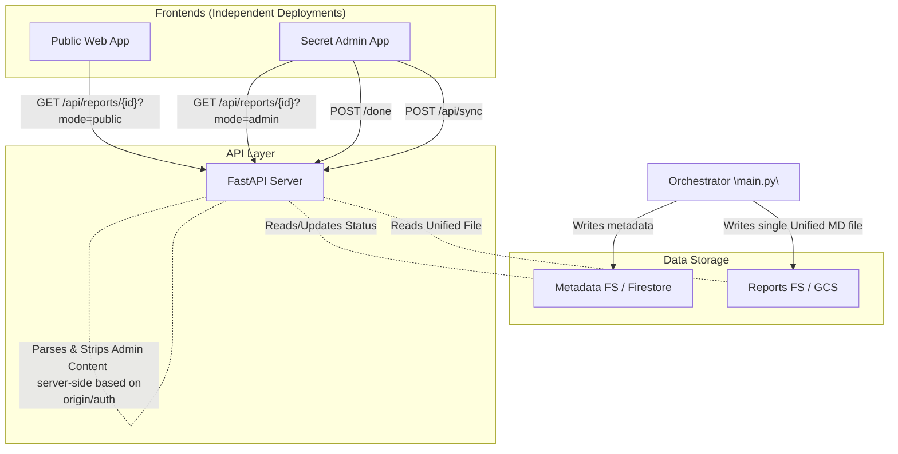

# System Architecture & Design

This document outlines the architecture, data flow, and key components of the "What's New in Gemini CLI" reporting application, focusing on its dual public/admin capabilities.

## Overview

The application is designed around two main entrypoints, decoupled through a unified storage layer:
1.  **The Orchestrator (`main.py`)**: A backend worker process that fetches new changelog entries, gathers relevant GitHub contextual data, and generates a **single, comprehensive markdown report** per feature using the Gemini LLM.
2.  **The API Server (`api.py`)**: A lightweight FastAPI server that serves the generated reports via REST endpoints. It securely strips admin content from public requests by validating a Secret Manager-injected API Key.
3.  **Unified Frontends**: Two separate Cloud Run deployments (Public and Admin). The Admin deployment is protected natively by Google Cloud IAM and injects the Secret Manager key into its API requests.

## Technology Stack

*   **Language**: Python 3.10+
*   **Web Framework**: FastAPI, Uvicorn (ASGI server)
*   **LLM Integration**: `@google/genai` (Google Gen AI SDK), `gemini-3-pro-preview` model
*   **Scraping**: `httpx` (HTTP client), `selectolax` (Performant HTML parser)
*   **Dependency Management**: `uv`

## Unified Report Architecture

To support both consumer reading and internal content planning, the application uses a Unified architecture. We generate **one** comprehensive report and parse it in the frontend using headings/sections.

## Agents Documentation

### 1. `ChangelogAgent` (`agents/changelog_agent.py`)
Responsible for monitoring the official Gemini CLI documentation site. Generates a unique `feature_id` hash to prevent redundant processing.

### 2. `GitHubAgent` (`agents/github_agent.py`)
Retrieves crucial context behind a feature by fetching PR Titles, Descriptions, and explicitly linked GitHub Issues.

### 3. `WriterAgent` (`agents/writer_agent.py`)
The intelligent core of the application responsible for converting bullet points and developer discussions into structured technical reports.
*   **Model**: Hardcoded currently to `gemini-3-pro-preview`.
*   **Output Structure**: Emits a single, comprehensive markdown string. The prompt instructs the LLM to use specific sections (e.g., specific H2 headers) for "Next Steps for Demos" so the frontend can easily parse and separate admin notes from public content.

## Service Endpoints (`api.py`)

| Method | Endpoint | Description |
| :--- | :--- | :--- |
| `GET` | `/api/reports` | Returns a JSON list of all generated features and their current review status, automatically sorted by version number. |
| `GET` | `/api/reports/{report_id}` | Retrieves the unified markdown content. **Security**: Requires `Authorization: Bearer <ADMIN_API_KEY>` header to return the full document; otherwise, the server explicitly severs the admin section. |
| `POST` | `/api/reports/{report_id}/done` | Marks a `report_id`'s status as "Done" within the metadata tasklist. **Security**: Requires valid `ADMIN_API_KEY`. |
| `POST` | `/api/sync` | Manually triggers the orchestrator by running `subprocess.run(["python", "main.py", "--check"])`. **Security**: Requires valid `ADMIN_API_KEY`. |
