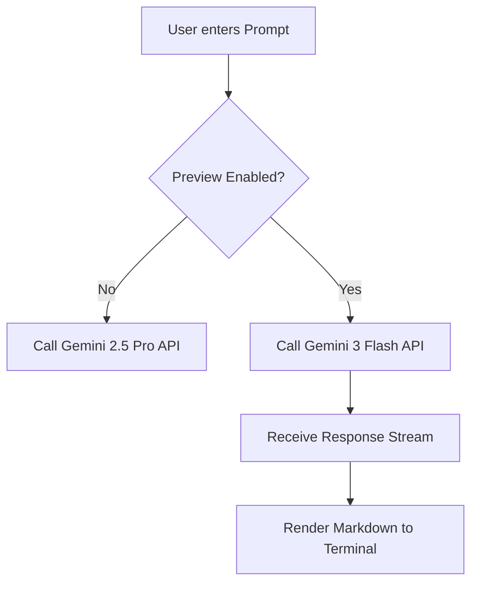

Here is the **What's New** report for the Gemini CLI update, focusing on the integration of Gemini 3 Flash.

***

# 🚀 What's New: Gemini 3 Flash Integration

## 1. Feature Summary
The Gemini CLI has been updated to support **Gemini 3 Flash**, Google’s latest high-efficiency multimodal model. This update positions Gemini 3 Flash as the new standard for interactive terminal workflows, offering a significant reduction in latency and cost compared to Gemini 2.5 Pro, while delivering reasoning capabilities that rival Gemini 3 Pro in many development scenarios.

To access this model, users must opt-in via the new **Preview Features** toggle within the CLI settings configuration.

## 2. Background & Context
**The Latency vs. Intelligence Trade-off**
In previous versions (v2.5 era), CLI users often faced a friction point: waiting for complex code generation or log analysis took long enough to break the developer's "flow state." While Gemini 2.5 Pro was accurate, the time-to-first-token (TTFT) was occasionally noticeable during rapid-fire debugging sessions.

**Why this change was made:**
*   **Speed:** Gemini 3 Flash is engineered for high-volume, low-latency tasks. For a CLI tool—where users expect near-instant feedback—this is a critical UX improvement.
*   **Cost-Efficiency:** As the CLI user base grows, API costs for heavy users (Paid tiers) become a factor. Flash provides a cheaper inference cost without sacrificing the reasoning depth required for typical DevOps and coding tasks.
*   **The "Preview" Flag:** By gating this behind a "Preview Features" flag, we ensure that stability is maintained for enterprise workflows on 2.5 Pro, while allowing power users and those on the waitlist to "live on the edge" with the newest model weights.

## 3. How-To Guide

Follow these steps to enable Gemini 3 Flash in your terminal environment.

### Prerequisites
Ensure your Gemini CLI is updated to the latest version.
```bash
# Example update command
npm install -g @google/gemini-cli@latest
# OR
pip install --upgrade gemini-cli
```

### Enabling the Model
1.  **Launch Settings:** Open the CLI interactive configuration.
    ```bash
    gemini settings
    ```
2.  **Navigate to Feature Flags:** Use your arrow keys to scroll down to the **Preview Features** section.
3.  **Enable Preview:** Toggle the setting to `TRUE` or `ENABLED`.
4.  **Select Model:** Once Preview is enabled, a new option will appear in your "Default Model" dropdown. Select `Gemini 3 Flash`.
5.  **Verify:** Exit settings and run a version check to confirm the active model.
    ```bash
    gemini --version --verbose
    > Current Model: gemini-3-flash-preview
    ```

## 4. Walkthrough / Technical Deep Dive

### Under the Hood: The "Preview" Switch
When you toggle **Preview Features**, the CLI modifies its local configuration file (typically `~/.gemini/config.json`).

*   **Before:** The CLI likely defaulted to a hardcoded stable endpoint (e.g., `models/gemini-2.5-pro`).
*   **After:** The CLI updates the API client initialization. It injects a new `model_name` parameter pointing to the experimental endpoint (e.g., `models/gemini-3-flash-001`).

### Latency Optimization
Gemini 3 Flash utilizes a distilled architecture. In the context of the CLI, this results in:
1.  **Faster Token Generation:** The stream of text returns to stdout significantly faster.
2.  **Larger Context Handling:** Flash typically handles large context windows more efficiently. If you pipe a massive `error.log` into the CLI, Flash will process the ingestion and start reasoning faster than 2.5 Pro due to optimized attention mechanisms.

### Logic Flow


## 5. Next Steps for Demos

If you are creating a video or live demo to showcase this update, focus on the **"Feel"** of the speed.

**Demo Idea 1: The "Side-by-Side" Race**
*   **Setup:** Split your terminal using `tmux` or multiple windows.
*   **Left Pane:** Gemini 2.5 Pro.
*   **Right Pane:** Gemini 3 Flash.
*   **Action:** Send the exact same complex prompt to both (e.g., "Write a Python script to scrape a website using BeautifulSoup and handle pagination").
*   **Outcome:** Visually demonstrate Flash finishing the output while Pro is still generating the middle section.

**Demo Idea 2: The "Massive Log" Ingestion**
*   **Setup:** Have a very large text file ready (e.g., a 10,000-line log file).
*   **Action:** Pipe the file into the CLI asking for a summary. `cat huge_log.txt | gemini "Find the root cause error"`
*   **Outcome:** Show how quickly Flash digests the context compared to previous versions.

**Demo Idea 3: The "Waitlist" Hook**
*   Show the `/settings` menu specifically. Walk through the UI of toggling the switch. This is a call-to-action for users to check if they have access.